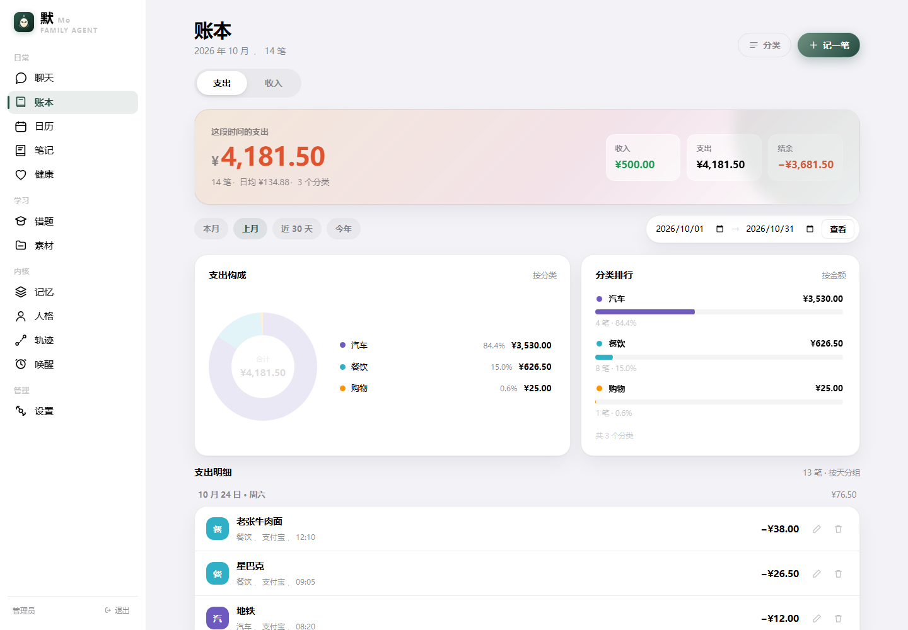
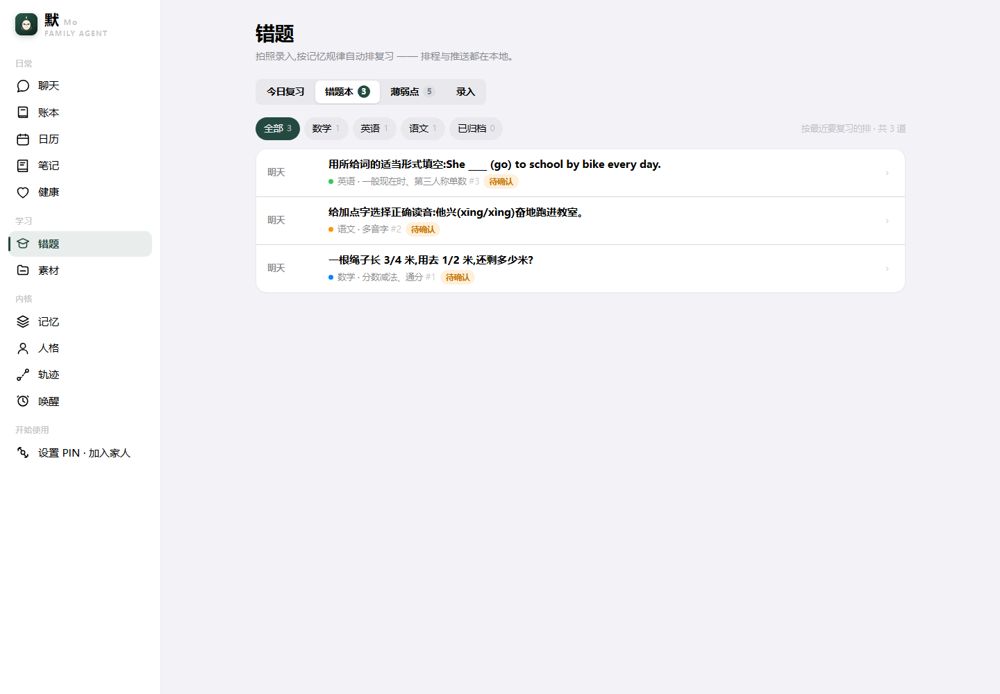
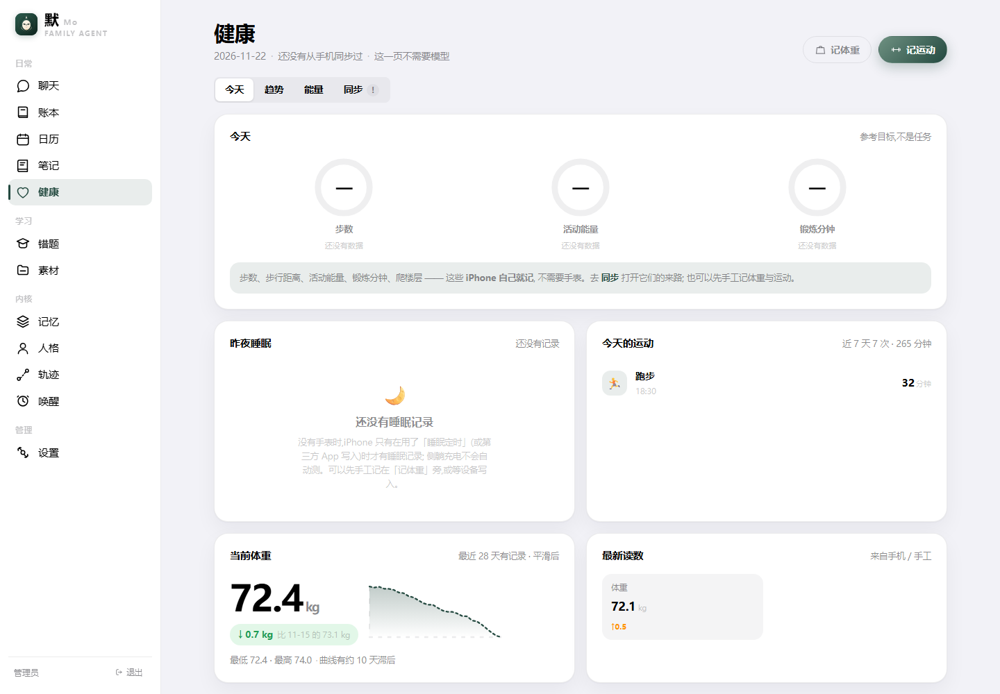

# Family Assistant · Life Assistant

[](https://github.com/dojels/life-assistant/actions/workflows/ci.yml)


A self-hosted AI assistant for your **home**, driven from WeChat: chat, long-term memory,
personal ledger, calendar, health tracking, and a shared mistake notebook for your kids.
Everything lives in a local SQLite database; the model is only called when you talk to it.



> Status: **0.1.0**, first public release. The UI is Chinese-only for now.

## Three things that make it different

**1. WeChat is the primary interface.** Each parent scans their own code and gets an
independent session and memory. Ask for a reminder, log an expense, or send a photo of a
worksheet — no app to install. (The WeChat bridge uses a self-registered iLink channel and is
off by default; without it the local web UI works the same.)

**2. Parents share one mistake notebook.** One photo → stem, cropped figure, answer and
analysis in a single model call. Spaced repetition (fixed interval or FSRS) pushes reviews on
schedule, weak knowledge points are aggregated, and a worksheet can be exported as HTML or print.
Every write leaves an undoable receipt.



**3. Long-term memory that asks first.** Candidate facts are extracted from conversation, then
the assistant asks "remember this?" before storing. Sensitive items (ID numbers, addresses,
phones) never enter the prompt by default. Facts, summaries and raw retrieval are budgeted
separately, and a wrong fact can be corrected, expired or reverted.



## What else is inside

Ledger (budgets, bill import, trends) · Calendar (month view, events, reminders, todos,
iCalendar subscription) · Health (weight/steps/sleep/workouts, Apple Health import, iOS
Shortcuts push) · Notes · Trace page (replay exactly what the model saw) · Usage report
(turns, tokens, cache hit rate, tool success rate).

## Quick start

Requires Python 3.12+ and a [DeepSeek](https://platform.deepseek.com/) API key.

```bash
git clone https://github.com/dojels/life-assistant.git
cd life-assistant
python -m venv .venv && source .venv/bin/activate   # Windows: .venv\\Scripts\\activate
pip install -e ".[tts]"
cp .env.example .env        # then set DEEPSEEK_API_KEY=sk-...
python -m la --web          # http://127.0.0.1:8765
```

No API key? Set `LA_LLM_PROVIDER=fake` — everything runs offline with canned replies.

## Configuration

Everything is configured via `.env`; the full commented list is in [`.env.example`](.env.example).
Key ones: `LA_LLM_PROVIDER`, `DEEPSEEK_API_KEY`, `LA_MODEL`, `LA_TIMEZONE`, `LA_DATA_DIR`,
`LA_WEB_ENABLED`, `DASHSCOPE_API_KEY` (optional TTS).

## Design choices worth knowing

- Prompts are assembled in code: the persona can be edited, the boundary section cannot.
- Tools are the only execution path: schema → phase gate → risk gate → timeout → redaction → audit.
- Every write leaves an undoable receipt; every fact needs user confirmation.
- Everything read is data, never instructions.
- SQLite with STRICT tables and ordered migrations — no ORM, no data loss on upgrade.

## Privacy

No telemetry. Chat content goes to the model provider you configure; images to its vision
endpoint; TTS text to Alibaba Cloud only if you set a key; web search is off by default.
See [docs/隐私与数据流向.md](docs/隐私与数据流向.md) (Chinese).

## Development

```bash
python -m unittest discover -s tests -t .   # ~3 minutes, 1776 tests
```

CI runs on Python 3.12 / 3.13 / 3.14 × Ubuntu / Windows. See [CONTRIBUTING.md](CONTRIBUTING.md).

## License

[MIT](LICENSE).
