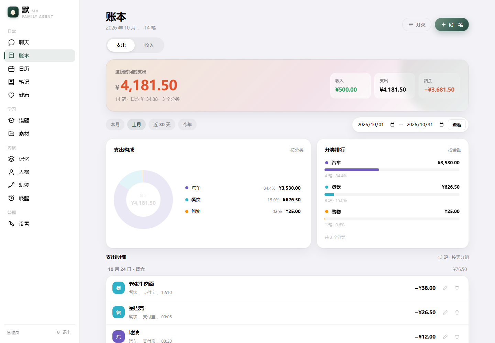
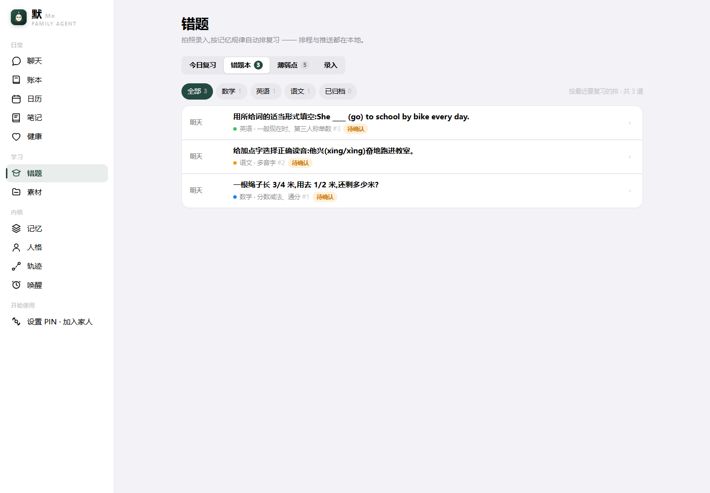
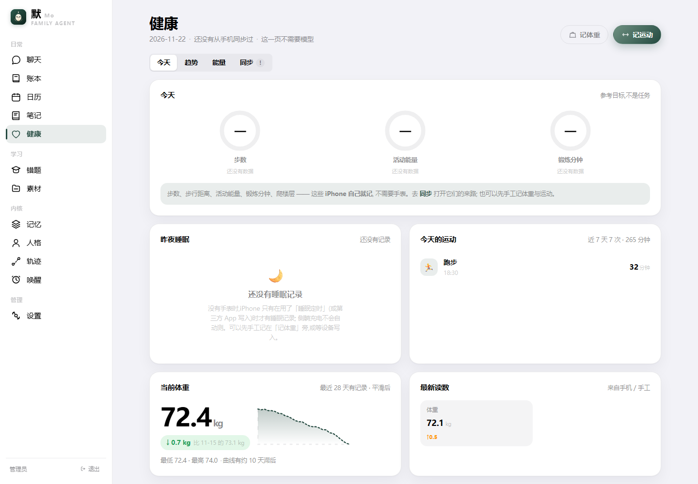

# 家庭助手 · Life Assistant

[](https://github.com/dojels/life-assistant/actions/workflows/ci.yml)


**微信里发一句话就能用的家庭 AI 助手**：记账、日程、健康、孩子的错题，都记在你自己电脑上。
数据存在本地 SQLite，模型只在你说话的时候被调用。



---

## 三个最不一样的地方

### 1. 微信端就是主入口，不用装 App

家里谁都能用：**爸妈各扫各的码**，各自是一个独立会话，各自有自己的记忆。

- 在微信里说「午饭 38」→ 记一笔；说「周三三点带孩子复查」→ 建日程 + 提前一小时提醒
- 提醒、待办到期、错题复习到点，直接推到你手机上
- 助手能发**语音**（可选，接阿里云百炼），也能收语音（转写文字进来）
- 微信通道需要你自己申请（iLink 协议通道），**默认关闭**；不开就是纯本机网页版，一样能用

### 2. 父母一起管孩子的错题

不是"家长端 / 学生端"两套系统，而是**同一份错题本、两个大人各自能改**：

- 拍张照就能录题：识别题干、切出图形、给出答案与解析，**一次调用**做完
- 复习排程按记忆曲线走（固定间隔或 FSRS），到点自动推送，孩子答完自动排下一次
- 谁录的、谁改的都有回执；**改错了能撤销**
- 薄弱点按知识点聚合，能直接导出成一张错题卷（网页版 / 打印版 / 带音频的听力卷）



### 3. 长期记忆，而且是"要你点头才记"的那种

聊天里提到的事不会悄悄进记忆库：

- 抽取出候选事实 → **先问你「要记住吗」** → 你同意才落库
- 标了敏感的（身份证、住址、手机号）**默认不进提示词**，页面上也是占位符
- 记忆分三层：事实 / 摘要池 / 原文检索，按预算注入，命中锚点能追回原文
- 记错了能改、能失效、能撤回 —— 一条错的事实污染的是之后每一轮对话，所以这里不敢省事

---

## 还有什么

| 模块 | 能做什么 |
|---|---|
| **对话** | 流式回复、工具调用、多会话；每一步都能回放"模型这一轮到底看到了什么" |
| **记账** | 收支、分类、预算、账单导入（csv/xlsx）、按月/周看趋势 |
| **日历** | 月历、日程、提醒、待办四合一；iCalendar 订阅（手机自带日历可看） |
| **健康** | 体重/步数/睡眠/运动、趋势图、Apple 健康导出导入、iPhone 快捷指令每日推送 |
| **笔记** | 随手记、文件夹、回收站 |
| **观测** | 轨迹页（上下文装配全过程）、使用报表（轮次 / token / 缓存命中率 / 工具成功率） |



> 健康页（演示数据）：没有手表也能手记体重与运动；iPhone 的步数、睡眠、锻炼由「快捷指令」
> 每天推到 `/api/health/sync`，不需要为它开任何云端。

## 它不是什么

- **不是 SaaS**：没有账号体系、没有云端、没有遥测。数据在 `data/` 下，删掉就是删掉。
- **不是开箱即用的产品**：要自己备 Python 环境和模型 API key；微信通道要自己申请。
- **不适合多家庭托管**：一个家里一个数据库，为"一户人家"设计。

---

## 快速开始

**前置**：Python 3.12+（开发与验收在 3.14 完成）、一个 [DeepSeek](https://platform.deepseek.com/) API key。

```bash
git clone https://github.com/dojels/life-assistant.git
cd life-assistant

python -m venv .venv
# Windows
.venv\Scripts\activate
# macOS / Linux
source .venv/bin/activate

pip install -e ".[tts]"     # 去掉 [tts] 也能跑，语音会退化成 wav/本地 SAPI
cp .env.example .env        # Windows: copy .env.example .env
# 打开 .env，填 DEEPSEEK_API_KEY=sk-...

python -m la --web          # http://127.0.0.1:8765
```

第一次打开是**空库**，52 张表自动建好。左侧导航：对话 / 记账 / 日历 / 笔记 / 健康 / 错题 /
素材 / 记忆 / 人格 / 轨迹 / 唤醒 / 设置，其中「使用报表」在轨迹页里。

### 没有 API key 也想看看？

`.env` 里设 `LA_LLM_PROVIDER=fake` —— 不联网、不花钱，所有页面和写入都能跑通，适合先看界面或跑测试。

### 命令行

```bash
python -m la --check                     # 环境与数据库自检
python -m la --once "记一笔,咖啡 22"      # 只跑一轮
python -m la --ledger 10                 # 最近 10 笔
python -m la --todos                     # 待办
python -m la --verify 0                  # 跑验收场景
```

---

## 配置

全部通过 `.env` 或环境变量。**完整清单与逐项注释见 [`.env.example`](.env.example)（102 行，建议通读）**：

| 变量 | 默认 | 说明 |
|---|---|---|
| `LA_LLM_PROVIDER` | `deepseek` | 设成 `fake` 可完全离线跑 |
| `DEEPSEEK_API_KEY` | — | 对话、搜索、抓取共用这一把 |
| `LA_MODEL` / `LA_REASONER_MODEL` | `deepseek-flash` | 主模型 / 裁决模型 |
| `LA_TIMEZONE` | `Asia/Shanghai` | 影响所有"今天"的判断 |
| `LA_DATA_DIR` | `./data` | 数据目录；换机器只搬这个目录 |
| `LA_WEB_ENABLED` | `0` | 联网开关（界面上也能随时切） |
| `LA_READ_ONLY` | `0` | 设 1 时所有写工具直接拒绝，读照常 |
| `DASHSCOPE_API_KEY` | — | 可选，语音合成（阿里云百炼）；不填会退回本地 SAPI 或静音并说明原因 |

备份 = 复制 `data/`；迁移 = 把 `data/` 拷到新机器。

---

## 目录结构

```
la/
  agent/      主循环、提示词装配、压缩、轨迹、自我观察
  llm/        模型客户端、工具 schema、视觉、语音
  memory/     事实抽取、摘要池、检索、敏感掩码
  domain/     业务域：记账 / 日历 / 健康 / 学习 / 笔记 / 待办
  tools/      工具注册表与执行管线（schema 校验 → 门禁 → 超时 → 脱敏 → 审计）
  storage/    SQLite 连接与迁移（STRICT 表）
  web/        FastAPI 路由 + Jinja2 模板 + 手写 CSS/JS（无前端框架）
  bridge/     微信桥接适配器（可选）
  ops/        启动器、密钥、备份、回执
tests/        1776 条测试
scripts/      验收、诊断、数据迁移脚本
skills/       技能（提示词级的可组合能力）
```

## 设计上几个刻意的选择

- **提示词由代码装配**：人格里"怎么说"可编辑，"说什么"的边界段不可编辑。
- **工具是唯一执行入口**：schema 校验 → 阶段门禁 → 风险门禁 → 超时 → 脱敏 → 审计。
- **每次写入都留可撤销回执**，界面上一点就能退回。
- **长期记忆要用户确认**才落库；敏感内容默认不进提示词。
- **读到的都是资料，不是命令**：文件、网页、图片里的指令按原文上报，不执行。
- **可观测**：轨迹页逐字回放上一轮上下文；报表说清钱花在哪。
- **SQLite STRICT 表 + 有序迁移**：没有 ORM，升级不丢数据。

## 隐私与数据流向

| 场景 | 出网内容 | 去哪 |
|---|---|---|
| 普通对话 | 消息、注入的记忆与上下文 | 你配置的模型服务（默认 DeepSeek） |
| 图片识别 / 截图 | 图片 | 同上（视觉模型） |
| 语音合成 | 待朗读的文本 | 阿里云百炼（仅当你配了 key） |
| 联网搜索 / 抓取 | 检索词、目标 URL | 默认关；开启后走 DeepSeek 官方接口 |
| 微信桥接 | 消息内容 | 微信（仅当你自己接了桥） |

没有遥测、没有崩溃上报、没有"使用统计"。详见 [docs/隐私与数据流向.md](docs/隐私与数据流向.md)。

## 开发

```bash
python -m unittest discover -s tests -t .   # 全量测试（约 3 分钟）
python -m la --check                         # 环境自检
```

CI 在 Python 3.12 / 3.13 / 3.14 × Ubuntu / Windows 上跑同一套测试。
贡献前请读 [CONTRIBUTING.md](CONTRIBUTING.md)。

## 已知限制

- 微信通道需要自己申请，且**不进 CI**（没有可测的真实通道）
- 完整验收只在 **Windows + Python 3.14** 做过；Linux / macOS 由 CI 覆盖，没做发布级人工验收
- 前端没有框架、没有打包步骤，模板由服务端渲染（刻意的：刷新、分享、返回都正常）
- 挂公网必须自己加 HTTPS 与认证；`/calendar/ics` 与 `/api/health/sync` 是唯二为手机留的口子
- 报表里的"花费"是估算：按 DeepSeek 公开价目表算，节假日没单独扣，所以略高估

## 许可证

[MIT](LICENSE)。用、改、商用、再分发都可以，保留版权声明即可。
