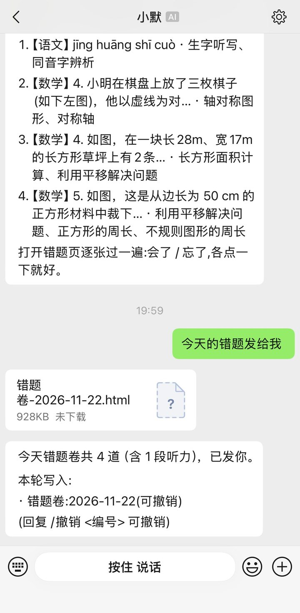
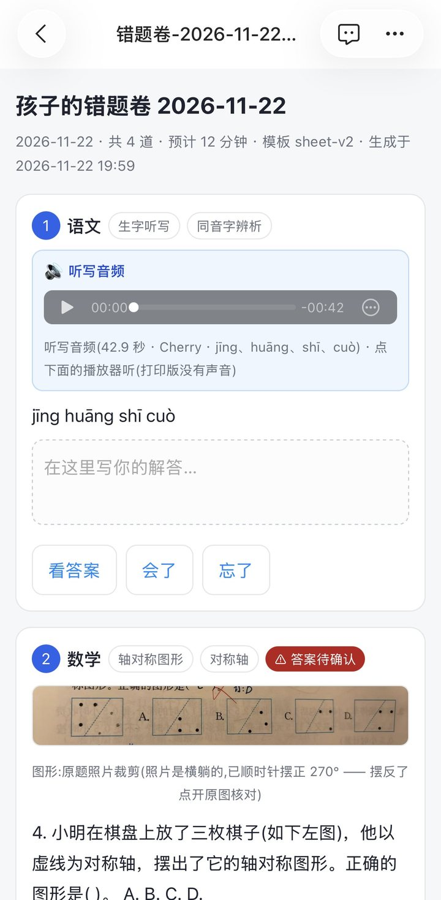

# 微信接入

家庭助手的微信端不是公众号、也不是企业微信，走的是**微信内置的 ClawBot 插件**（iLink 协议）：
它允许一个自建的 bot 以一个"联系人"的身份收发消息。所以它看起来就是一个普通微信好友
——点进去能聊天、能发文件、能收提醒。



> 上面这张是真机截图：说一句「今天的错题发给我」，它把生成的错题卷 HTML 当附件发回来，
> 并且列出「本轮写入」和撤销方式。内容来自演示数据。

---

## 前提

1. **微信里要有 ClawBot 插件入口**：手机微信 → 我 → 设置 → 插件。
   没有这个入口就接不了，这与本项目无关，是微信侧的灰度能力。
2. 一台**常开的机器**（家里的小主机 / 云服务器）。进程不在 = 收不到消息。
3. 不需要开微信桌面客户端。

## 登录（二选一）

### 方式 A：网页扫码（推荐）

```bash
python -m la --web
```

浏览器打开 <http://127.0.0.1:8765> → 左侧「设置」→ 顶部 **微信** 页签：

- 点「生成二维码」→ 用手机微信扫码 → 手机上点确认
- 页面会实时显示状态（等待扫码 / 已扫码待确认 / 已登录）
- 登录成功后，凭据写入 `data/wechat/credentials.json`

### 方式 B：命令行

```bash
# 独立的小登录器(默认端口 8788,登录成功后自动退出)
python -m la.bridge.adapters.weixin_login_server

# 或者直接用常驻进程的入口:第一次运行会自动走扫码
python -m la.bridge.adapters.weixin_ilink_main
```

## 常驻

登录只是拿到凭据，要收消息还得让桥接进程跑着：

```bash
# 前台跑(看日志方便,先这样验证)
python -m la.bridge.adapters.weixin_ilink_main

# 只读观察:正常轮询但**绝不回复** —— 建议第一周这么跑,确认它不会乱说话
python -m la.bridge.adapters.weixin_ilink_main --dry-run

# 冒烟:只拉一轮就退出,确认链路通
python -m la.bridge.adapters.weixin_ilink_main --once
```

Windows 上直接双击 `launcher.cmd`：它会把 Web 和**所有已登录的微信号**一起拉起来，
再双击一次是重启；`launcher.cmd status` 看状态，`launcher.cmd logs wechat` 看日志。

Linux 上用手写的 systemd 单元（`life-assistant-wechat@<账号>`），或自己写一个：

```ini
[Unit]
Description=Mo Family Agent wechat bridge
After=network-online.target

[Service]
WorkingDirectory=/opt/mo-family-agent
Environment=LA_DATA_DIR=/opt/mo-family-agent/data
ExecStart=/opt/mo-family-agent/.venv/bin/python -m la.bridge.adapters.weixin_ilink_main
Restart=always
RestartSec=5

[Install]
WantedBy=multi-user.target
```

## 爸妈各一个号（多账号）

一个进程只服务一个微信号，多号就是多进程，凭据与游标彼此隔离：

```bash
python -m la.bridge.adapters.weixin_ilink_main --account dad
python -m la.bridge.adapters.weixin_ilink_main --account mom
```

凭据落在 `data/wechat/accounts/<账号>/credentials.json`。启动器会自动发现
`data/wechat/accounts/` 下**每一个已登录**的账号并各自拉起进程，不需要你手动登记。

每个号在系统里是一个**独立会话**：记忆、上下文、压缩互不干扰；但领域数据（账本、日历、
孩子的错题）是全家共享的一份——这正是"爸爸妈妈都能管同一本错题"的实现方式。

## 掉线与重连

| 现象 | 处理 |
|---|---|
| 手机上删除了这个 bot / 换了号 | `--relogin`，或设置页点「重新登录」 |
| 日志里有 `SessionExpired` | 同上；桥接会一直重试直到你重扫 |
| 进程活着但收不到消息 | 先看 `launcher.cmd status` 里端口/进程是否正常，再看日志 |
| 想换绑另一个微信号 | 用不同 `--account` 名，旧的直接删掉对应目录 |

## 能力与边界

**能做的**

- 纯文本对话（含工具调用：记账、日程、错题、健康……）
- 收发文件/图片：照片进来会存素材并识别；生成的错题卷、音频按「回执」发出去
- 语音：收到语音时用微信的转写文字当正文；发语音需要配 `DASHSCOPE_API_KEY`（阿里云百炼）
- **主动推送**：提醒、待办到期、错题复习到点

**做不到 / 要注意**

- ⚠️ **提醒推送依赖这个进程**：主动发消息需要一个内存里的 `context_token`，它只存在于
  长轮询的桥接进程里。Web 进程的后台心跳推不了提醒，只能推错题清单。
- ⚠️ 进程不在 = 所有消息都收不到（微信不会重投）。重启后只补发**待发队列**里未过期的消息。
- 微信通道**不进 CI**：没有可测的真实通道，改动只能靠真机验证。
- 遵守微信的使用条款：这是自建 bot，不是官方开放平台应用，账号风险自负。

## 安全

`data/wechat/credentials.json` **等同于你的微信身份**，拿到它就能以这个 bot 的身份收发消息：

- 它在 `.gitignore` 里，**不要提交、不要发给别人、不要贴进任何对话窗口**
- 备份 `data/` 时注意，这份文件也在里面
- 桥接进程只需要**出网**（长轮询），不需要公网入口；对外只暴露 Web 的
  `/calendar/ics` 与 `/api/health/sync` 这两条手机用的路径即可（见 `SECURITY.md`）

---



> 手机上点开附件就是当天生成的错题卷：听力题带播放器，图形题带裁剪后的图，
> 答案不确定的会标「答案待确认」，孩子答完点「会了 / 忘了」。
